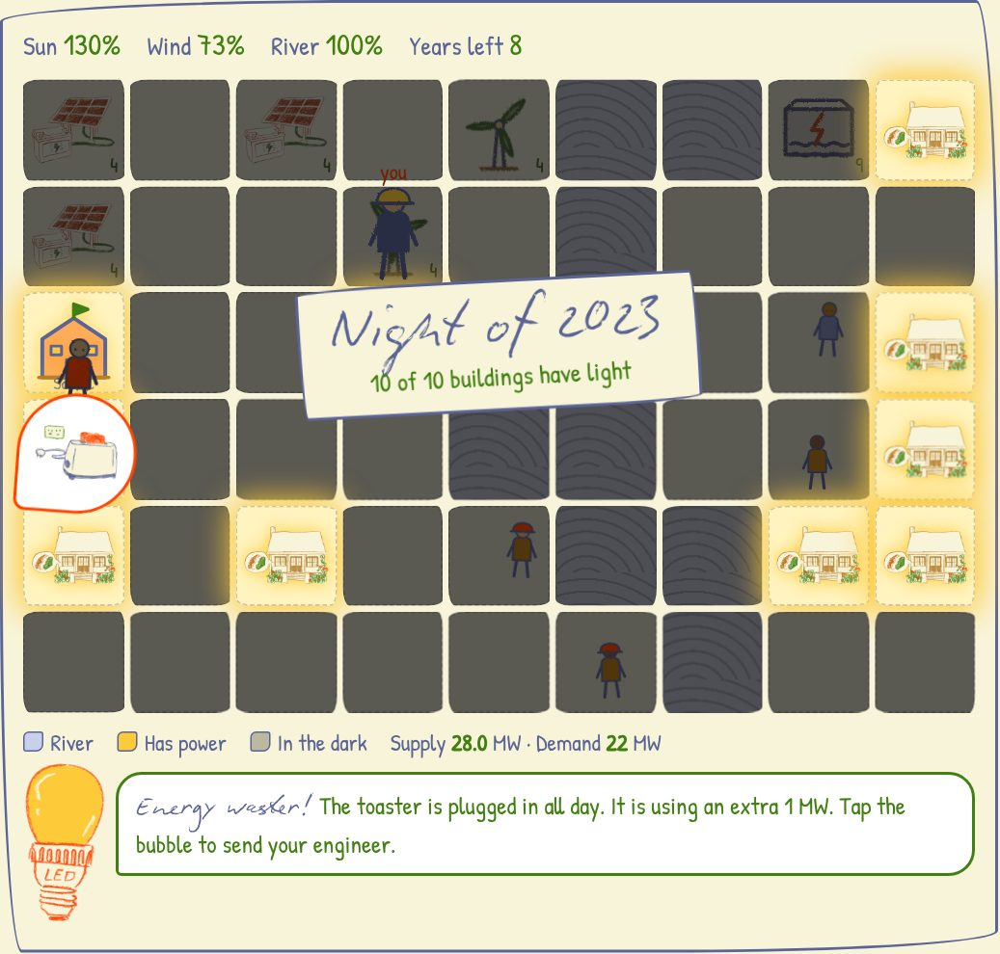

# ✦ Light the Valley ✦

### A hand-drawn energy game about **SDG 7: Affordable and clean energy**

**[▶ Play it in your browser](https://n1x-plut0.github.io/sdg-7-/)**

*No download, no sign-up. Works on a laptop or a phone.*

---

## It's 2021. The valley is in the dark.

Families in a small river valley have no electricity. You're their energy engineer.
By **2030**, can you give every home, the new school and the health clinic **clean, affordable power**
without filling the air with smog?

That's the real promise of the UN's Sustainable Development Goal 7:
*"Ensure access to affordable, reliable, sustainable and modern energy for all."*

## What you do

| | |
|---|---|
| **Build** | Solar farms, wind turbines, small hydro by the river, or cheap but dirty coal. Your engineer walks across the map and builds it. |
| **Upgrade** | LED bulbs and insulation, so a building needs less power. That's target 7.3, energy efficiency. |
| **Be an energy detective** | Air conditioners, lamps, computers, fans, toasters and chargers left on pop up over houses. Tap them before they waste your power. |
| **Watch the night fall** | At the end of every year the valley goes dark, and you see which windows glow. |
| **Complete missions** | 11 missions, from your first solar panel to powering the clinic that keeps vaccines cold. |
| **Dress up** | Earn sparks and spend them in the wardrobe on engineer outfits (Sunny, Forest ranger, Sunset, Night glow) and map styles (Autumn, Blueprint). |

## Every year is different

The sun, wind and river change each year. Droughts slow your hydro, still years stop your turbines,
and a climate fund might send you $40k. Coal is always ready, but each plant adds pollution every year,
and at 100 the game is over.

**Score up to 3 stars in 2030:**
✦ every building powered ✦ at least 80% clean power ✦ air pollution under 30

## Meet Watt

Watt is the little LED bulb in the corner. Watt explains what's happening, warns you about dark homes
and smog, and shares a real energy-saving tip every time you catch an energy waster.

## Learn while you play

Each year shows a real SDG 7 fact, for example:

- Around 670 million people still lived without electricity in the early 2020s.
- Solar electricity got about 90% cheaper between 2010 and 2020.
- LED bulbs use up to 80% less electricity than old bulbs.
- About 2.3 billion people still cook with polluting fuels.

---

## Play locally

Download or clone this repo and open `index.html` in any browser. That's it.

## Fonts

The game is styled after our class presentation and uses **Biro Script Plus** (headings) and
**Linotype Feltpen** (text). These are licensed fonts, so they are **not** included in this repo.
If they're installed on your computer, the game uses them automatically. You can also put licensed
web font files in `assets/fonts/` named `BiroScriptPlus.woff2` and `LinotypeFeltpen.woff2`.
Without them, the game falls back to the free Google Fonts *Caveat* and *Patrick Hand*.

## Credits

- Drawings of the house, solar panel, LED bulb, appliances and stars come from our SDG 7 presentation.
- Facts: UN Sustainable Development Goals, SDG 7 targets 7.1, 7.2, 7.3 and 7.b.

## Coming next

Sound, a short tutorial, batteries and storage, clean cooking stoves, more maps and levels.
