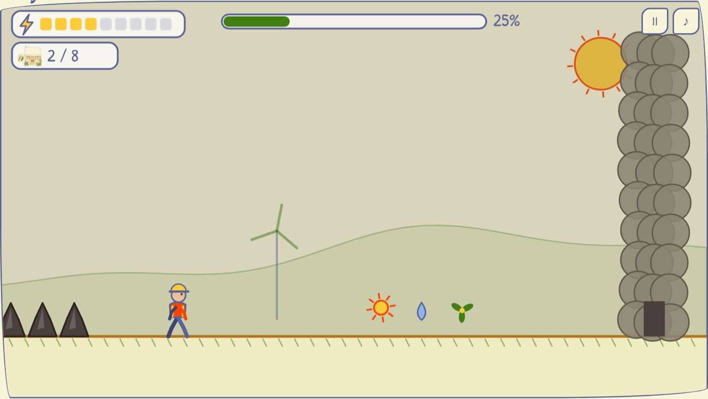
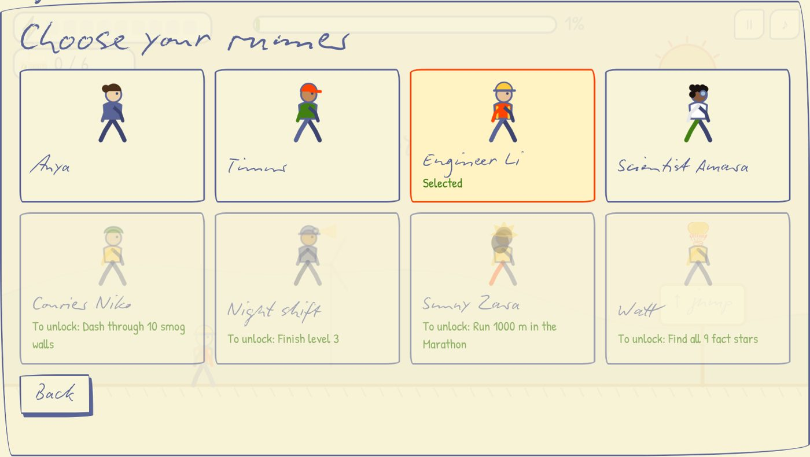
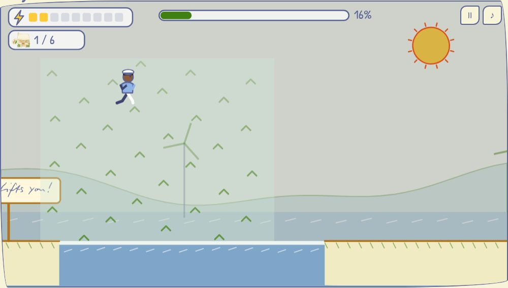
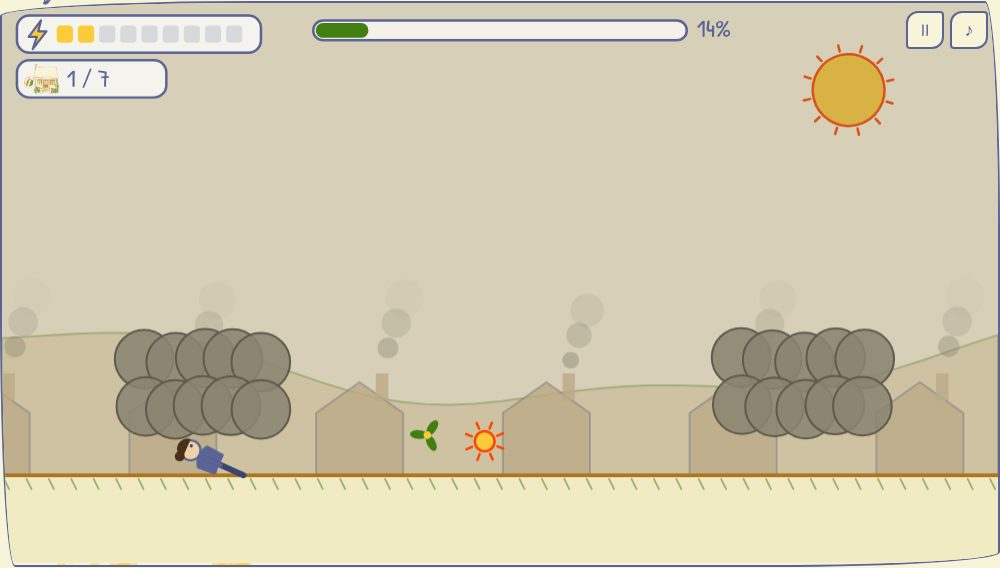
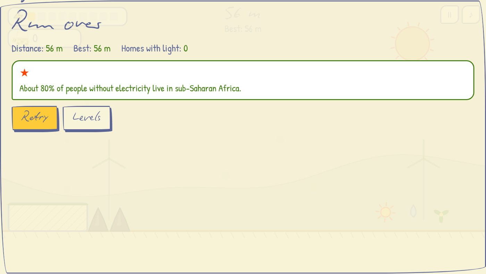
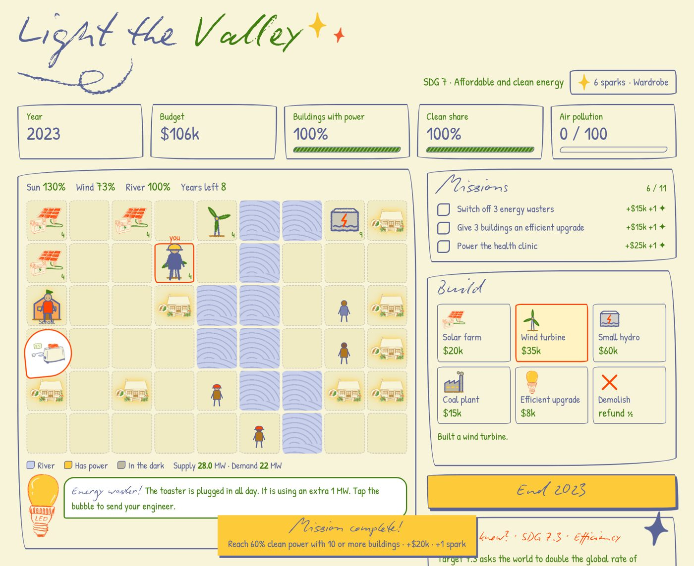

# ✦ Light Dash ✦

### A runner game about clean energy for everyone

**SDG 7: Affordable and clean energy**

**[▶ Play in your browser](https://n1x-plut0.github.io/sdg-7-/)**

*No download, no sign-up. Works on a laptop or a phone.*

*Also on Netlify: [splendorous-gumption-10c31d.netlify.app](https://splendorous-gumption-10c31d.netlify.app)*

---

## Run. Collect energy. Light up homes.

About **685 million people** in the world still live without electricity.
Your runner races through villages, hills and a city. Collect energy from the sun, wind and water,
give it to homes in the dark, and dash through coal smog.
**The more homes glow, the clearer the sky gets.**

That's the UN's Sustainable Development Goal 7:
*"Ensure access to affordable, reliable, sustainable and modern energy for all"* by 2030.

## Arrow-key controls

| Key | What it does |
|:---:|---|
| **↑** (or Space) | Jump. Hold to keep jumping. Press it on a yellow sun in the air to jump again. |
| **↓** | Duck under a smog cloud. In the air: drop fast. |
| **→** | Dash through a smog wall. Costs 1 ⚡. |
| **←** | Light the home next to you. Costs 1 ⚡. |

On a phone, use the big arrow buttons under the screen.

## What's inside

- **9 levels across all parts of SDG 7**, each with its own look:

  | Level | SDG 7 target | Where you run |
  |---|---|---|
  | 1. Village in the dark | 7.1 Access for all | A village waiting for light |
  | 2. Windy hills | 7.2 Renewable energy | Hills full of wind turbines |
  | 3. Smart city | 7.3 Energy efficiency | City windows light up as you go |
  | 4. Clean kitchen | 7.1 Clean cooking | Chimneys stop smoking as homes get clean energy |
  | 5. Mini-grid island | 7.b Infrastructure | Fly over the sea on updrafts |
  | 6. Grid 2030 | 7.a Working together | Under the power lines, at top speed |
  | 7. Solar desert | 7.2 Renewable energy | Solar farms and speed arrows |
  | 8. River dam | 7.b Infrastructure | A hydropower dam, slow and fast sections |
  | 9. Night of 2030 | 7.3 Energy around the clock | The final night run: lit homes shine in the dark |

- **Updrafts:** green wind currents that carry you over wide gaps.
- **Speed arrows:** green arrows speed you up, yellow ones slow you down, blue ones bring back normal speed.
- **Daily quests:** three new quests every day (light 15 homes, ride 5 updrafts…), with a daily streak.
- **Marathon 2030:** an endless run through all nine worlds. Can you make it 2030 meters?
- **13 runners:** Anya, Timur, Engineer Li, Scientist Amara, Courier Niko, Night shift, Sunny Zara, Watt (the light bulb from our presentation), Chef Mei, Captain Kai, Ada of Grid 2030, Hydro Hana, the Golden runner, Explorer Sol, River guard Nadia, Astronaut Yuki, Grandpa Ken and Robot Volt (18 in total).
- **30 achievements** that unlock new runners.
- **27 fact stars** hidden in the levels. Each one reveals a real fact about SDG 7.
- **SDG 7 Book:** all five targets of Goal 7 explained, plus your collection of facts.
- **Leaderboards:** pick a nickname (no email or password) and compare score, Marathon distance, fastest time on each level and quests completed.
- **Stats table:** your homes lit, energy, attempts, best % and best time for every level.
- **Practice mode:** respawn at checkpoint flags while you learn a level.
- **Menu demo:** while you're in the menu, a runner plays the level in the background.
- English and Russian.

  

  

  

## Facts from the game

- About 80% of people without electricity live in sub-Saharan Africa.
- About 2.1 billion people cook with wood, coal or kerosene.
- From 2010 to 2020, electricity from solar panels got about 90% cheaper.
- An LED bulb uses about 75–80% less electricity than an old incandescent bulb.
- Smoke from cooking on open fires causes about 3.2 million deaths a year (WHO).
- A solar mini-grid can power a whole village far away from the national grid.

…and 21 more facts are waiting in the levels.

---

## Another game: Light the Valley

Our first game is a calm strategy game: build solar, wind and hydro power for a valley from 2021 to 2030.
**[▶ Play Light the Valley](https://n1x-plut0.github.io/sdg-7-/valley.html)**

## Play locally

Download or clone this repo and open `index.html` in any browser. That's it.

## Leaderboard (Netlify)

The leaderboard runs as a small Netlify function (`netlify/functions/leaderboard.mjs`) that stores scores in Netlify Blobs.
To turn it on: sign in to [Netlify](https://app.netlify.com) with GitHub, choose **Add new project → Import an existing project → GitHub → sdg-7-**, and deploy.
Netlify reads `netlify.toml`, so no settings are needed. The game on the Netlify address finds the leaderboard by itself;
the GitHub Pages copy uses the address in `leaderboard-config.js`
(currently https://splendorous-gumption-10c31d.netlify.app).

Players choose only a nickname. Each browser gets a secret key, so nobody else can overwrite your row.

## Fonts

The games are styled after our class presentation and use **Biro Script Plus** (headings) and
**Linotype Feltpen** (text). These are licensed fonts, so they are **not** included in this repo.
If they're installed on your computer, the games use them automatically. You can also put licensed
web font files in `assets/fonts/`, named `BiroScriptPlus.woff2` and `LinotypeFeltpen.woff2`.
Without them, the games fall back to the free Google Fonts Caveat, Patrick Hand and Neucha.

## Credits

- Drawings of the house, solar panel, LED bulb, appliances and stars come from our SDG 7 presentation.
- Facts: UN Sustainable Development Goals, SDG 7 targets 7.1, 7.2, 7.3 and 7.b, and the *Tracking SDG 7* report.
